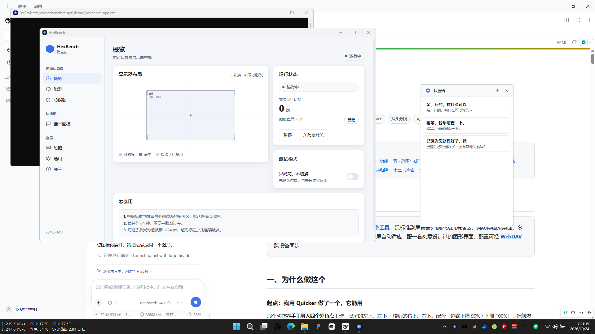
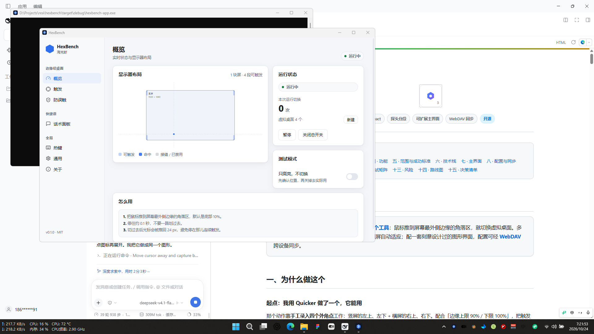
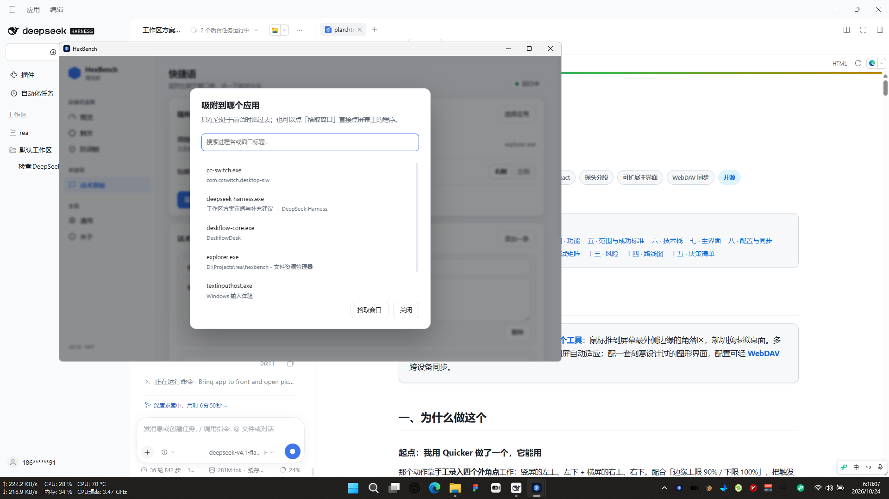

# HexBench

> **Switch Windows virtual desktops by pushing the mouse to the outermost edge of your screens.**

A small, tray-resident toolbox for Windows 11. Multi-monitor aware, zero configuration, and it runs on its own — no host app required.

**[中文文档](README.md) · MIT · Tauri 2 + React**

---

## What's inside

### Tool 1 — edge-triggered virtual desktops

Push the cursor into the corner zone at the **outermost** edge of the whole desktop, rest for ~100 ms, and HexBench switches to the previous/next virtual desktop.

- Works with any monitor arrangement: ultrawide + vertical, side by side, stacked
- Only the *outermost* edges trigger — the seam between two monitors is ignored
- Hot-plug a display, change resolution, rotate — it re-reads the layout automatically
- Test mode highlights the live zone without switching

### Tool 2 — quick-phrase panel (快捷语)

A small panel that docks beside a chat app (built for 千牛, works with anything). Click a phrase to fill it into the focused input, or enable "fill & send" to submit it.

| Feature | |
| --- | --- |
| Docking | outside or **inside** the target window, left or right |
| Picking | search list, click-to-pick, or match by window class/title |
| Collapse | the panel folds into a draggable bubble |
| No focus steal | the panel uses `WS_EX_NOACTIVATE`, so your input keeps focus |

<p>
  
  
  
</p>

### Shared plumbing

- **Global hotkeys** — every shortcut is registered in one place (`全局 → 热键`), so tools never fight over a combo
- **WebDAV config sync** — upload/pull `config.json`; the password is stored with Windows DPAPI and never uploaded
- **One-click updates** — signed updates via the Tauri updater: download, silent NSIS install, automatic restart. No installer wizard.

## Install

Grab the latest installer from [Releases](https://github.com/punwong/hexbench/releases/latest).

- Windows 10 1809+ / Windows 11, x64
- WebView2 runtime (preinstalled on Windows 11)
- Package is signed for updates (minisign); the executable itself is not code-signed yet

winget manifests are prepared under `winget/` but not merged into [winget-pkgs](https://github.com/microsoft/winget-pkgs) yet.

## Build

```powershell
pnpm install
pnpm tauri dev      # hot-reloading dev build
pnpm tauri build    # release build; add TAURI_SIGNING_PRIVATE_KEY to sign updater artifacts
```

Requires Rust 1.85+, Node 22+, pnpm 10+, and the MSVC toolchain.

Tests and lints:

```powershell
cargo test --workspace
cargo clippy --workspace --all-targets -- -D warnings
```

## Configuration

Everything lives in one file: `%APPDATA%\io.github.hexbench\config.json`

| Section | What it holds |
| --- | --- |
| `trigger` | which edges/ratio trigger a desktop switch |
| `guard` | apps that suppress triggering while in front |
| `hotkeys` | pause and phrase-panel shortcuts |
| `phrases` | panel target app, side, inside/outside, phrases, send-on-click |
| `sync` | WebDAV URL, user, DPAPI-sealed password |
| `updates` | optional endpoint override (use a mirror instead of GitHub) |

## Updates

HexBench checks `https://github.com/punwong/hexbench/releases/latest/download/latest.json`, verifies the minisign signature of the installer, then runs it in NSIS passive mode and restarts into the new version.

You can point it at your own mirror in `关于 → 更新源` if GitHub is slow on your network.

To publish a release: bump the version in `Cargo.toml` and `src-tauri/tauri.conf.json`, then push a `v*` tag — CI builds, signs, generates `latest.json` and publishes the release.

## Roadmap

- [x] Edge-triggered virtual desktop switching
- [x] Quick-phrase panel with docking
- [x] Global hotkey registry
- [x] WebDAV config sync
- [x] Signed one-click updates + CI releases
- [x] winget manifests (PR [microsoft/winget-pkgs#460910](https://github.com/microsoft/winget-pkgs/pull/460910) pending review)
- [ ] SignPath code signing (pending approval)
- [ ] Scoop bucket
- [ ] Conflict handling / auto-pull for WebDAV sync

## License

MIT — see [LICENSE](LICENSE). The project name and icon are not part of the license; forks should rename and re-icon.
